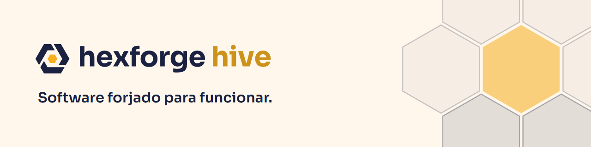

<picture>
  <source media="(prefers-color-scheme: dark)" srcset="./assets/hexforge-hive-github-banner-dark.png">
  
</picture>

## Hola, somos Hexforge Hive

Creamos y operamos nuestros propios productos de software desde Colombia. Cada uno resuelve un trabajo concreto del día a día de una empresa, y todos se construyen igual: pieza por pieza, como las celdas de una colmena.

### Nuestros productos

| Producto | Para qué sirve |
| --- | --- |
| **Depothive** | Inventario por bodegas, con señalización física para encontrar cada cosa en su lugar |
| **Moldhive** | Inventario y catálogo de moldes 3D |
| **Vetmimo** | Software para veterinarias, con avatares animados de las mascotas |

### Cómo trabajamos

- **Claro antes que complicado.** Explicamos lo técnico en palabras simples.
- **Honestos con lo que hay.** Si una función todavía no existe, lo decimos.
- **Con oficio.** Cuidamos el detalle, porque lo que sale de aquí tiene que aguantar.

Hexforge Hive · Software forjado para funcionar.
